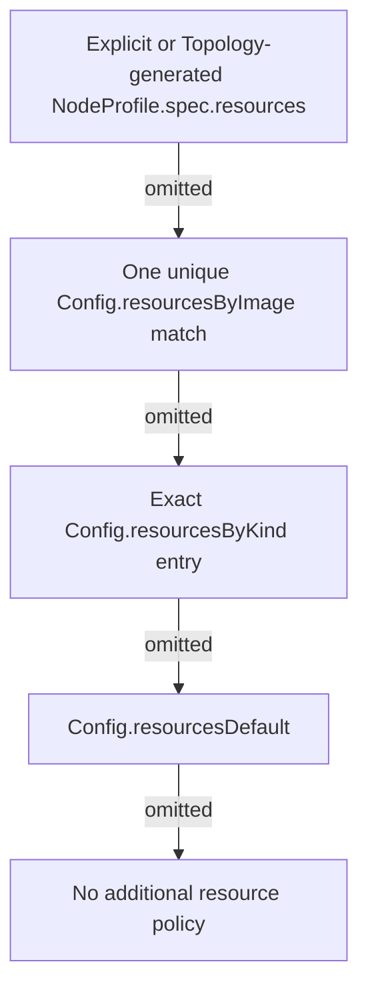

This guide explains how to configure resource limits, requests, node scheduling, and tolerations for Clabernetes topologies.

## Overview

Clabernetes allows fine-grained control over:

- **Resource requests/limits**: CPU and memory for device Pods
- **Node selectors**: Control which Kubernetes nodes run your topology
- **Tolerations**: Run on tainted nodes

## Resource Configuration

### Per-Topology Resources

Set resources at the topology level:

```yaml
apiVersion: c9s.run/v1alpha1
kind: Topology
metadata:
  name: with-resources
spec:
  deployment:
    resources:
      default:  # Applied to all nodes
        requests:
          memory: "2Gi"
          cpu: "1"
        limits:
          memory: "4Gi"
          cpu: "2"
```

### Per-Node Resources

Override resources for specific nodes:

```yaml
spec:
  deployment:
    resources:
      default:
        requests:
          memory: "2Gi"
          cpu: "1"
      # High-resource node
      core-router:
        requests:
          memory: "16Gi"
          cpu: "8"
        limits:
          memory: "32Gi"
          cpu: "16"
      # Minimal resource node
      host:
        requests:
          memory: "512Mi"
          cpu: "250m"
```

For a Topology, the compiler emits one shared NodeProfile for the default policy and a
complete dedicated NodeProfile only for a Node whose resource policy differs. Every emitted
Node receives an explicit `profileRef`; profiles do not inherit from one another.

### Direct Node and NodeProfile Resources

When authoring the primary API directly, put resource policy on a NodeProfile and reference
it explicitly from each intended Node. Profile resources apply to each logical Node's primary
application container; component containers keep the requirements their imported plan declares:

```yaml
apiVersion: c9s.run/v1alpha1
kind: NodeProfile
metadata:
  name: high-capacity
spec:
  resources:
    requests:
      memory: "16Gi"
      cpu: "8"
---
apiVersion: c9s.run/v1alpha1
kind: Node
metadata:
  name: core-router
spec:
  kind: nokia_srlinux
  image: ghcr.io/nokia/srlinux:latest
  profileRef:
    name: high-capacity
```

The reference is same-namespace and singular. NodeProfiles are never selected by labels or
merged by priority.

### Global Resources (Config CRD)

The singleton Config supports exact-kind defaults, image-regexp defaults, and a final generic
fallback. With Helm, put the same fields under `globalConfig.deployment` in your values file;
do not edit the generated Config concurrently with a values-managed installation.

```yaml
apiVersion: c9s.run/v1alpha1
kind: Config
metadata:
  name: clabernetes
spec:
  deployment:
    # Used only when no profile, image, or kind entry applies.
    resourcesDefault:
      requests:
        cpu: 500m
        memory: 1Gi

    # Exact, case-sensitive kind names. Aliases are independent keys.
    resourcesByKind:
      nokia_srlinux: &srl-requests
        requests:
          cpu: "2"
          memory: 2Gi
      srl: *srl-requests

    # RE2 expressions match the complete source image reference, including its tag.
    resourcesByImage:
      '^registry\.example/srlinux:26\..*$':
        requests:
          cpu: "4"
          memory: 8Gi
```

New installations include request-only recommendations for every supported kind and alias. See
[Shipped kind request defaults](#shipped-kind-request-defaults).

#### Selection and matching

For each logical Node's primary application container, c9s selects exactly one resource block:



Image entries intentionally outrank kind entries so a custom image can override its stock kind
default. Kind matching is exact and case-sensitive against the declared containerlab kind; there
is no expression or magic `default` key. For example, `srl` does not inherit an entry that exists
only for `nokia_srlinux`.

Image expressions are RE2 regular expressions with implicit full-reference anchoring. `srlinux`
does not match `ghcr.io/nokia/srlinux:26.3`; use an expression such as
`^ghcr\.io/nokia/srlinux:.*$`. Matching uses the planned primary container's source reference,
including repository and tag, even when containerlab supplied a kind's default image. It never
uses the digest-resolved reference or an auxiliary/internal image. More than one matching
expression is an error, as is an invalid expression. c9s reports the matching patterns in sorted
order and does not mutate the affected Deployment; it never resolves ambiguity by pattern length
or map order.

#### Whole blocks, empty blocks, and quantities

The selected resource blocks are not deep-merged across layers. If a NodeProfile declares only a
CPU request, it does not inherit memory requests from a matching kind entry. An explicit empty
block suppresses lower-priority policy:

```yaml
apiVersion: c9s.run/v1alpha1
kind: NodeProfile
metadata:
  name: unreserved-device
spec:
  resources: {} # no global CPU/memory policy is applied
```

An explicit `{}` value in `resourcesByKind` or `resourcesByImage` likewise suppresses lower layers.
This is different from an omitted map/key. A selected block still overlays only the resource names
it declares onto imported requirements, preserving unrelated planned values.

Policy applies independently to every logical Node's declared primary application container,
including grouped Nodes of different kinds. Non-primary component and internal containers keep
the requirements imported from their device plans. Singleton Config changes re-evaluate Nodes;
explicit profiles continue to win.

### Containerlab `cpu` and `memory`

A node definition may size its own container with containerlab vocabulary: `cpu` (vcpus) and
`memory` (for example `1Gb`) become device-container Kubernetes CPU and memory limits. `cpu-set`
is rejected because CPU pinning has no portable Pod mapping. For a resource name that the selected
profile/global block also sets, that selected block wins on the logical primary container. The
shipped kind defaults contain requests only, so they do not replace these limits:

```yaml
apiVersion: c9s.run/v1alpha1
kind: Node
metadata:
  name: srl1
spec:
  kind: nokia_srlinux
  image: ghcr.io/nokia/srlinux:latest
  cpu: 2
  memory: 4Gb
```

VM guest RAM and c9s memory requests are related but not identical. The shipped VM baselines add
QEMU/container headroom and do not change `QEMU_SMP`, `QEMU_MEMORY`, or another image-specific
sizing variable. If you retune a VM's vCPU/RAM, resize its NodeProfile too. Shipped defaults do not
set CPU/memory limits: requests reserve scheduling capacity without introducing a c9s-selected
CPU throttle or OOM ceiling.

### Adopting kind/image defaults on upgrade

Bootstrap deliberately avoids silently resizing existing labs:

- Fresh Config creation receives the shipped `resourcesByKind` and `resourcesByImage` maps.
- During `merge` upgrades, a nil map stays nil, preserving an existing installation's generic
  `resourcesDefault` behavior. Review and copy the desired map entries from the chart's
  `values.yaml` into the Config to opt in.
- Once a map is explicitly present, later merges add absent shipped keys without replacing your
  values for existing keys. A map you enable remains independent of the other map.
- `globalConfig.mergeMode: overwrite` retains replacement semantics. It can replace these maps,
  your custom entries, and every other Config field; review the complete Config before using it.

Set a feature map to `null` to stop using it without selecting defaults on the next merge. Setting
the map itself to `{}` instead marks it as enabled, allowing future merges to add shipped entries.
An empty `{}` **entry for one kind or image** has the different purpose described above: it
suppresses lower-priority policy for that match.

Removing a previously used map changes requests on the next reconciliation. Check worker allocatable
capacity before opting in, especially for VM-backed kinds, and use NodeProfiles for image versions
or hardware types whose requirements differ from the documented baseline.

## Shipped Kind Request Defaults

The tables below are the reviewed, request-only defaults in `charts/clabernetes/values.yaml` for the
pinned containerlab v0.83.0 registry. Aliases share the canonical entry listed in the same row.
"Reviewed baseline" means the pinned sources do not declare a per-container requirement; it is not
a claim about a vendor-certified minimum. Values are scheduling requests, not runtime sizing knobs.
Native containers have no QEMU allocation to mirror. VM memory adds headroom to the documented or
encoded guest RAM (normally 1 GiB, rounded for small VMs); the sources and guest values remain
visible in the basis column.

### Native-container NOS kinds

| Kind and aliases | CPU / memory | Basis and limitations |
| --- | --- | --- |
| `6wind_vsr` | 2 / 4Gi | Reviewed native-container baseline; [kind guide](https://github.com/srl-labs/containerlab/blob/v0.83.0/docs/manual/kinds/6wind_vsr.md). |
| `arista_ceos`, `ceos` | 1 / 2Gi | Reviewed cEOS baseline; [kind guide](https://github.com/srl-labs/containerlab/blob/v0.83.0/docs/manual/kinds/ceos.md). |
| `c8000`, `cisco_c8000` | 4 / 22Gi | Fixed-form recommendation of 4 cores/20 GB plus headroom; modular systems need a larger profile. [Resource table](https://github.com/srl-labs/containerlab/blob/v0.83.0/docs/manual/kinds/c8000.md#hardware-resource-requirements). |
| `cisco_iol`, `cisco_vios` | 1 / 1Gi | IOL minimum 768 MB; vIOS router/switch defaults 512/768 MB, rounded up. [IOL requirements](https://github.com/srl-labs/containerlab/blob/v0.83.0/docs/manual/kinds/cisco_iol.md#resource-requirements), [vIOS launch](https://github.com/srl-labs/vrnetlab/blob/master/cisco/vios/docker/launch.py). |
| `cisco_xrd`, `xrd` | 2 / 4Gi | Reviewed native XRd baseline; [kind guide](https://github.com/srl-labs/containerlab/blob/v0.83.0/docs/manual/kinds/xrd.md). |
| `cjunosevolved`, `juniper_cjunosevolved` | 4 / 10Gi | Host preflight minimum 4 vCPU/8 GB plus 2 GiB native-container headroom. [Kind defaults](https://github.com/srl-labs/containerlab/blob/v0.83.0/nodes/cjunosevolved/cjunosevolved.go). |
| `crpd`, `juniper_crpd`, `juniper_csrx` | 1 / 2Gi | Reviewed compact Junos container baseline; [cRPD](https://github.com/srl-labs/containerlab/blob/v0.83.0/docs/manual/kinds/crpd.md) and [cSRX](https://github.com/srl-labs/containerlab/blob/v0.83.0/docs/manual/kinds/csrx.md) guides. |
| `cvx`, `cumulus_cvx` | 1 / 1Gi | Containerlab applies 512 MB for 4.3.0 and 768 MB otherwise; request rounds up for processes. [Memory defaults](https://github.com/srl-labs/containerlab/blob/v0.83.0/nodes/cvx/cvx.go). |
| `keysight_ixia-c-one` | 2 / 4Gi | Reviewed primary-application baseline only; auxiliary components keep planned requirements. [Kind guide](https://github.com/srl-labs/containerlab/blob/v0.83.0/docs/manual/kinds/keysight_ixia-c-one.md). |
| `nokia_srlinux`, `srl` | 2 / 2Gi | Containerlab host preflight requires 2 vCPU and 2 GB; large hardware types need profiles. [Host requirements](https://github.com/srl-labs/containerlab/blob/v0.83.0/nodes/srl/srl.go), [type guidance](https://github.com/srl-labs/containerlab/blob/v0.83.0/docs/manual/kinds/srl.md). |
| `nokia_srsim` | 4 / 8Gi | Distributed-chassis CPM baseline from the existing c9s guide; sizes only CPM-A, not linecards. [c9s SR-SIM guide](/docs/guides/nokia-srsim), [host requirements](https://github.com/srl-labs/containerlab/blob/v0.83.0/nodes/sros/sros.go). |
| `sonic-vs` | 2 / 4Gi | Reviewed native SONiC baseline; [kind guide](https://github.com/srl-labs/containerlab/blob/v0.83.0/docs/manual/kinds/sonic-vs.md). |
| `spirent_stc` | 2 / 4Gi | Reviewed primary TestCenter container baseline; [kind guide](https://github.com/srl-labs/containerlab/blob/v0.83.0/docs/manual/kinds/spirent_stc.md). |
| `veesix_osvbng` | 1 / 2Gi | Reviewed osvbng container baseline; [kind guide](https://github.com/srl-labs/containerlab/blob/v0.83.0/docs/manual/kinds/veesix_osvbng.md). |
| `fdio_vpp`, `frr`, `frrouting`, `linux`, `rare`, `tailscale` | 250m / 512Mi | Reviewed lightweight container baselines; [FRR](https://github.com/srl-labs/containerlab/blob/v0.83.0/docs/manual/kinds/frr.md), [VPP](https://github.com/srl-labs/containerlab/blob/v0.83.0/docs/manual/kinds/fdio_vpp.md), [Linux](https://github.com/srl-labs/containerlab/blob/v0.83.0/docs/manual/kinds/linux.md), [freeRtr](https://github.com/srl-labs/containerlab/blob/v0.83.0/docs/manual/kinds/rare-freertr.md), [Tailscale](https://github.com/srl-labs/containerlab/blob/v0.83.0/nodes/tailscale/tailscale.go). |

### VM-backed kinds

| Kind and aliases | CPU / memory request | VM allocation basis before headroom |
| --- | --- | --- |
| `ale_vaos` | 2 / 3Gi | 2 vCPU / 2 GB. [Launch defaults](https://github.com/srl-labs/vrnetlab/blob/master/ale/vaos/docker/launch.py). |
| `arista_veos`, `vr-veos`, `vr-arista_veos` | 2 / 3Gi | 2 vCPU / 2 GB from the launch script. [Launch defaults](https://github.com/srl-labs/vrnetlab/blob/master/arista/veos/docker/launch.py). |
| `arrcus_arcos` | 4 / 17Gi | 4 vCPU / 16 GB. [Launch defaults](https://github.com/srl-labs/vrnetlab/blob/master/arrcus/arcos/docker/launch.py). |
| `aruba_aoscx`, `vr-aoscx`, `vr-aruba_aoscx` | 4 / 9Gi | 4 vCPU / 8 GB. [Launch defaults](https://github.com/srl-labs/vrnetlab/blob/master/aruba/aoscx/docker/launch.py). |
| `checkpoint_cloudguard` | 1 / 5Gi | Reviewed generic 1 vCPU / 4 GB + 1 GiB VM baseline; pinned [kind guide](https://github.com/srl-labs/containerlab/blob/v0.83.0/docs/manual/kinds/checkpoint_cloudguard.md) declares no quantity. |
| `ciena_saos`, `vr-ciena_saos` | 2 / 9Gi | 2 vCPU / 8196 MB. [Resource table](https://github.com/srl-labs/containerlab/blob/v0.83.0/docs/manual/kinds/ciena_saos.md). |
| `cisco_asav` | 1 / 3Gi | 1 vCPU / 2 GB. [Launch defaults](https://github.com/srl-labs/vrnetlab/blob/master/cisco/asav/docker/launch.py). |
| `cisco_c8000v` | 1 / 5Gi | 1 vCPU / 4 GB. [Resource table](https://github.com/srl-labs/containerlab/blob/v0.83.0/docs/manual/kinds/vr-c8000v.md). |
| `cisco_cat9kv` | 4 / 19Gi | 4 vCPU / 18 GiB. [Pinned defaults](https://github.com/srl-labs/containerlab/blob/v0.83.0/nodes/vr_cat9kv/vr-cat9kv.go), [minimum guidance](https://github.com/srl-labs/containerlab/blob/v0.83.0/docs/manual/kinds/vr-cat9kv.md). |
| `cisco_csr1000v`, `vr-csr`, `vr-cisco_csr1000v` | 1 / 5Gi | 1 vCPU / 4 GB. [Launch defaults](https://github.com/srl-labs/vrnetlab/blob/master/cisco/csr1000v/docker/launch.py). |
| `cisco_ftdv` | 4 / 9Gi | 4 vCPU / 8 GB. [Launch defaults](https://github.com/srl-labs/vrnetlab/blob/master/cisco/ftdv/docker/launch.py). |
| `cisco_n9kv`, `vr-n9kv`, `vr-cisco_n9kv` | 4 / 11Gi | 4 vCPU / 10 GB; N9KV-lite can use a smaller profile. [Kind guide](https://github.com/srl-labs/containerlab/blob/v0.83.0/docs/manual/kinds/vr-n9kv.md). |
| `cisco_sdwan` | 1 / 17Gi | Default `manager` type: 1 vCPU / 16 GB. Controller/validator types are smaller; use profiles. [Resource table](https://github.com/srl-labs/containerlab/blob/v0.83.0/docs/manual/kinds/cisco_sdwan.md#hardware-resource-requirements). |
| `cisco_xrd_vrouter` | 4 / 11Gi | Containerlab override: 4 vCPU / 10 GiB; hugepage requirements remain separate. [Pinned defaults](https://github.com/srl-labs/containerlab/blob/v0.83.0/nodes/cisco_xrd_vrouter/cisco_xrd_vrouter.go), [resource guide](https://github.com/srl-labs/containerlab/blob/v0.83.0/docs/manual/kinds/cisco_xrd_vrouter.md). |
| `cisco_xrv`, `vr-xrv`, `vr-cisco_xrv` | 1 / 5Gi | 1 vCPU; launch default 3 GiB, documentation recommends at least 4 GiB, plus headroom. [Launch](https://github.com/srl-labs/vrnetlab/blob/master/cisco/xrv/docker/launch.py), [RAM guidance](https://github.com/srl-labs/vrnetlab/blob/master/cisco/xrv/README.md). |
| `cisco_xrv9k`, `vr-xrv9k`, `vr-cisco_xrv9k` | 2 / 17Gi | Containerlab override: 2 vCPU / 16 GiB, rather than newer upstream defaults. [Pinned defaults](https://github.com/srl-labs/containerlab/blob/v0.83.0/nodes/vr_xrv9k/vr-xrv9k.go), [requirement guide](https://github.com/srl-labs/containerlab/blob/v0.83.0/docs/manual/kinds/vr-xrv9k.md). |
| `dell_ftosv`, `vr-ftosv`, `vr-dell_ftosv` | 4 / 5Gi | 4 vCPU / 4 GB. [Launch defaults](https://github.com/srl-labs/vrnetlab/blob/master/dell/ftosv/docker/launch.py). |
| `dell_sonic`, `plvision_sonic`, `sonic-vm` | 2 / 5Gi | 2 vCPU / 4 GB. [Dell SONiC launch](https://github.com/srl-labs/vrnetlab/blob/master/dell/dell_sonic/docker/launch.py), [PLVision](https://github.com/srl-labs/vrnetlab/blob/master/plvision/plvision_sonic/docker/launch.py), [generic SONiC](https://github.com/srl-labs/vrnetlab/blob/master/sonic/docker/launch.py). |
| `f5_bigip-ve` | 4 / 9Gi | 4 vCPU / 8 GB. [Kind guide](https://github.com/srl-labs/containerlab/blob/v0.83.0/docs/manual/kinds/f5_bigipve.md). |
| `fortinet_fortigate`, `fortinet_fortiproxy` | 2 / 3Gi | 2 vCPU / 2 GB. [Pinned defaults](https://github.com/srl-labs/containerlab/blob/v0.83.0/nodes/fortinet_fortigate/fortigate.go). |
| `generic_vm` | 1 / 5Gi | Reviewed generic 1 vCPU / 4 GB + 1 GiB baseline; actual images vary. [Kind guide](https://github.com/srl-labs/containerlab/blob/v0.83.0/docs/manual/kinds/generic_vm.md), [common VM defaults](https://github.com/srl-labs/vrnetlab/blob/master/common/vrnetlab.py). |
| `huawei_vrp` | 2 / 3Gi | Containerlab default 2 vCPU / 2 GB. Releases requiring 8 cores/8 GB need profiles. [Pinned defaults](https://github.com/srl-labs/containerlab/blob/v0.83.0/nodes/huawei_vrp/huawei_vrp.go), [image variation](https://github.com/srl-labs/vrnetlab/blob/master/huawei/huawei_vrp/docker/launch.py). |
| `ipinfusion_ocnos` | 2 / 5Gi | 2 vCPU / 4 GB. [Launch defaults](https://github.com/srl-labs/vrnetlab/blob/master/ipinfusion/ocnos/docker/launch.py). |
| `juniper_vjunosevolved` | 4 / 9Gi | 4 vCPU / 8 GB. [Launch documentation](https://github.com/srl-labs/vrnetlab/blob/master/juniper/vjunosevolved/README.md). |
| `juniper_vjunosrouter`, `juniper_vjunosswitch` | 4 / 6Gi | 4 vCPU / 5 GB. [vJunos router](https://github.com/srl-labs/vrnetlab/blob/master/juniper/vjunosrouter/README.md), [vJunos switch](https://github.com/srl-labs/vrnetlab/blob/master/juniper/vjunosswitch/README.md). |
| `juniper_vmx`, `vr-vmx`, `vr-juniper_vmx` | 4 / 7Gi | 3 vFPC + 1 VCP CPU and 4 + 2 GB RAM. [VM requirements](https://github.com/srl-labs/vrnetlab/blob/master/juniper/vmx/README.md). |
| `juniper_vqfx`, `vr-vqfx`, `vr-juniper_vqfx` | 2 / 5Gi | Reviewed two-VM baseline: up to 4 GB combined guest RAM plus headroom. [Launch defaults](https://github.com/srl-labs/vrnetlab/blob/master/juniper/vqfx/docker/launch.py). |
| `juniper_vsrx`, `vr-vsrx`, `vr-juniper_vsrx` | 2 / 5Gi | 2 vCPU / 4 GB. [Launch defaults](https://github.com/srl-labs/vrnetlab/blob/master/juniper/vsrx/docker/launch.py). |
| `mikrotik_ros`, `vr-ros`, `vr-mikrotik_ros` | 1 / 512Mi | 1 vCPU / 256 MB x86 RAM plus small-VM headroom; ARM and high-interface-count images need more. [Launch defaults](https://github.com/srl-labs/vrnetlab/blob/master/mikrotik/routeros/docker/launch.py). |
| `nokia_sros`, `vr-sros`, `vr-nokia_sros` | 2 / 5Gi | 2 vCPU / 4 GB control-plane baseline plus headroom; linecard and chassis variants need profiles. [Variant guide](https://github.com/srl-labs/containerlab/blob/v0.83.0/docs/manual/kinds/vr-sros.md). |
| `nvidia_cumulusvx` | 2 / 5Gi | 2 vCPU / 4 GB. [VX requirements](https://github.com/srl-labs/vrnetlab/blob/master/nvidia/cumulus-vx/README.md). |
| `paloalto_panos`, `vr-pan`, `vr-paloalto_panos` | 2 / 7Gi | Containerlab override: 2 vCPU / 6 GiB. [Pinned defaults](https://github.com/srl-labs/containerlab/blob/v0.83.0/nodes/vr_pan/vr-pan.go). |
| `vyosnetworks_vyos` | 1 / 5Gi | Reviewed generic 1 vCPU / 4 GB + 1 GiB VM baseline; [kind guide](https://github.com/srl-labs/containerlab/blob/v0.83.0/docs/manual/kinds/vyosnetworks_vyos.md). |

### Lightweight VM and infrastructure kinds

| Kind | CPU / memory request | Basis |
| --- | --- | --- |
| `mikrotik_chr` | 1 / 512Mi | 1 vCPU and 256 MiB + 8 MiB per data interface/vCPU, with small-VM headroom; increase with interface count. [Formula](https://github.com/srl-labs/containerlab/blob/v0.83.0/docs/manual/kinds/mikrotik_chr.md#resources). |
| `openbsd`, `freebsd` | 1 / 1Gi | 1 vCPU / 512 MB plus headroom. [OpenBSD](https://github.com/srl-labs/vrnetlab/blob/master/openbsd/README.md), [FreeBSD](https://github.com/srl-labs/vrnetlab/blob/master/freebsd/README.md). |
| `openwrt` | 1 / 512Mi | 1 vCPU / 128 MB plus small-VM headroom. [Requirements](https://github.com/srl-labs/vrnetlab/blob/master/openwrt/README.md). |

### Explicit registry exclusions

These registered containerlab names are not ordinary direct device application Pods, so c9s ships
no kind request for them:

| Kind | Why it is excluded |
| --- | --- |
| `host` | Host namespace connectivity is represented by host Links. |
| `bridge`, `ovs-bridge` | Linux/OVS bridges are host connectivity resources, not device application containers. |
| `ext-container` | The workload is external to c9s rather than a c9s-created device Pod. |
| `k8s-kind` | A nested kind cluster is not a direct device application container. |

## Node Scheduling

### Node Selectors

Schedule pods on specific Kubernetes nodes:

```yaml
spec:
  deployment:
    scheduling:
      nodeSelector:
        kubernetes.io/arch: amd64
        node-type: network-lab
        disktype: ssd
```

Pods will only run on nodes with ALL specified labels.

### Label Your Nodes

```bash
# Add labels to nodes
kubectl label node worker-1 node-type=network-lab
kubectl label node worker-2 node-type=network-lab

# Verify labels
kubectl get nodes --show-labels
```

### Global Node Selectors by Image

In the Config CRD, map node selectors to image patterns:

```yaml
apiVersion: c9s.run/v1alpha1
kind: Config
metadata:
  name: clabernetes
spec:
  deployment:
    nodeSelectorsByImage:
      "ghcr.io/nokia/srlinux*":
        node-type: srl-capable
        kubernetes.io/arch: amd64
      "internal.io/nokia_sros*":
        node-type: baremetal
        hardware: kvm-enabled
      "default":
        node-type: standard
```

The longest matching pattern takes precedence.

## Tolerations

Run pods on tainted nodes:

```yaml
spec:
  deployment:
    scheduling:
      tolerations:
        - key: "dedicated"
          operator: "Equal"
          value: "network-lab"
          effect: "NoSchedule"
        - key: "nvidia.com/gpu"
          operator: "Exists"
          effect: "NoSchedule"
```

### Taint Your Nodes

```bash
# Add taint
kubectl taint nodes worker-1 dedicated=network-lab:NoSchedule

# Verify taints
kubectl describe node worker-1 | grep Taints

# Remove taint
kubectl taint nodes worker-1 dedicated=network-lab:NoSchedule-
```

## Affinity Rules

Affinity rules apply to direct device Pods and use the native Kubernetes affinity structure. They
can require or prefer particular Kubernetes nodes with `nodeAffinity`, or place device Pods in
relation to other Pods with `podAffinity` and `podAntiAffinity`.

### Topology-level affinity

Set affinity under `spec.deployment.scheduling` to apply one scheduling policy to all device Pods
generated for a Topology:

```yaml
apiVersion: c9s.run/v1alpha1
kind: Topology
metadata:
  name: scheduled-topology
spec:
  deployment:
    scheduling:
      affinity:
        nodeAffinity:
          requiredDuringSchedulingIgnoredDuringExecution:
            nodeSelectorTerms:
              - matchExpressions:
                  - key: topology.kubernetes.io/zone
                    operator: In
                    values:
                      - zone-a
                      - zone-b
        podAntiAffinity:
          preferredDuringSchedulingIgnoredDuringExecution:
            - weight: 100
              podAffinityTerm:
                labelSelector:
                  matchLabels:
                    c9s.run/topologyOwner: scheduled-topology
                topologyKey: kubernetes.io/hostname
```

The Topology controller copies this policy into its generated shared NodeProfile. Dedicated
profiles generated for resource overrides retain the same topology-wide affinity.

### NodeProfile-level affinity

For directly authored Nodes, put the same affinity structure on a NodeProfile and reference it
from each Node that should use the policy:

```yaml
apiVersion: c9s.run/v1alpha1
kind: NodeProfile
metadata:
  name: network-lab-scheduling
spec:
  scheduling:
    affinity:
      nodeAffinity:
        preferredDuringSchedulingIgnoredDuringExecution:
          - weight: 80
            preference:
              matchExpressions:
                - key: node-type
                  operator: In
                  values:
                    - network-lab
---
apiVersion: c9s.run/v1alpha1
kind: Node
metadata:
  name: srl1
spec:
  profileRef:
    name: network-lab-scheduling
  kind: nokia_srlinux
  image: ghcr.io/nokia/srlinux:latest
```

One NodeProfile can be referenced by multiple Nodes. If Nodes share one Pod through
`network-mode: container:<primary>`, the primary Node's NodeProfile controls that shared Pod.
Affinity `labelSelector` fields select peer Pods for pod affinity or anti-affinity; they do not
select which Nodes receive a NodeProfile.

## Complete Example

Comprehensive scheduling configuration:

```yaml
apiVersion: c9s.run/v1alpha1
kind: Topology
metadata:
  name: production-lab
spec:
  deployment:
    resources:
      default:
        requests:
          memory: "4Gi"
          cpu: "2"
        limits:
          memory: "8Gi"
          cpu: "4"
      spine1:
        requests:
          memory: "16Gi"
          cpu: "8"
    scheduling:
      nodeSelector:
        kubernetes.io/arch: amd64
        node-type: network-lab
        storage: nvme
      tolerations:
        - key: "dedicated"
          operator: "Equal"
          value: "network-lab"
          effect: "NoSchedule"
  definition:
    containerlab: |
      name: production
      topology:
        nodes:
          spine1:
            kind: nokia_srlinux
            image: ghcr.io/nokia/srlinux:latest
          leaf1:
            kind: nokia_srlinux
            image: ghcr.io/nokia/srlinux:latest
```

## Troubleshooting

### Pods Stuck in Pending

Check events:

```bash
kubectl describe pod <pod-name>
```

Common causes:

- No nodes match selector
- Insufficient resources
- Node taints not tolerated

### Finding Suitable Nodes

```bash
# List nodes with labels
kubectl get nodes -L node-type,disktype

# Check node resources
kubectl describe node <node-name> | grep -A10 "Allocated resources"
```

### Resource Pressure

Check if nodes have capacity:

```bash
kubectl top nodes
kubectl describe node <node-name> | grep -A5 "Allocated"
```

## Privileged Mode

Each device container receives exactly the privilege, capabilities, and devices its containerlab
kind declares, including any `privileged`, `cap-add`, or `devices` vocabulary in the node
definition itself. Privilege is never a NodeProfile or Config setting.

## Related

- [Example: with-resources.yaml](https://github.com/clabernetes/clabernetes/blob/main/examples/deployment/with-resources.yaml)
- [Example: with-scheduling.yaml](https://github.com/clabernetes/clabernetes/blob/main/examples/deployment/with-scheduling.yaml)
- [CRD Reference: Deployment](/docs/crd/topology)
- [CRD Reference: NodeProfile](/docs/crd/node-profile)
